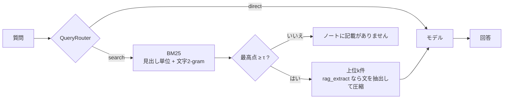

# local-rag-evaluation-pipeline

ローカルで動かすLLMの性能を、個人的なノートを使ったRAGで比べるための評価基盤です。
評価の対象はモデルです。検索・ルーター・文脈の圧縮は、どのモデルにも同じ条件で文脈を渡すための土台として、標準的なものを簡潔に実装しています。
Python 3.11以上の標準ライブラリにのみ依存します。

## 使い方

1. 評価したいモデルを、ローカルのサーバに入れます。Ollamaの例:

   ```bash
   ollama pull qwen3:1.7b
   ```

2. `models.toml` に、評価したいモデルを `[[models]]` で書きます(例として小型モデルを3つ書いてあります)。使わないモデルは `enabled = false` にします。
3. モデルが入っているかを確かめます。

   ```bash
   python bench.py --check
   ```

4. 評価します。モデル × 条件の表が出て、1問ごとの生の結果が `results/日時.jsonl` に残ります。

   ```bash
   python bench.py
   ```

モデルや条件を絞るときは `--models qwen3-1.7b --conditions rag,oracle` を、1問ごとの回答を見るときは `--detail` を付けます。
1問だけ試すときは `python rag_agent.py "受注番号はどんな形式?" --model qwen3-1.7b` を使います。`--model` を省くと、モデルに送るプロンプトを表示するだけです。`--agent` を付けると、検索をモデルに任せて、検索語と返した節も表示します。

## 構成

```text
├── models.toml     # 評価するモデルの一覧
├── settings.toml   # 検索の件数、閾値τ、圧縮の文数、生成の設定、プロンプトのテンプレート、評価条件
├── mock.md         # 評価用のノート(架空の会社の業務引き継ぎ書、20節・約8,500字)
├── cases.json      # 試験28件
├── cases_dev.json  # 調整用の開発用の試験11件(--cases で指定)
├── rag_agent.py    # 基盤: 分割、BM25、ルーター、文脈の圧縮、プロンプトの組み立て
├── models.py       # モデルの呼び出し
├── bench.py        # モデル評価、比較表の出力
└── tests/          # 偽のHTTPサーバをモデルの代わりにした unittest(python -m unittest)
```



### モデルの書き方(`models.toml`)

| 項目 | 内容 |
| --- | --- |
| `name` | 識別用の名前（重複不可） |
| `backend` | `"ollama"`(`/api/chat`)か `"openai"`(OpenAI互換の `/v1/chat/completions`。llama.cpp、LM Studio、vLLM など) |
| `model` | サーバ側のモデル名 |
| `base_url` | サーバのURL(`/v1` は付けない)。ノートを外に出さないよう、`127.0.0.1`、`localhost`、`::1` に限定 |
| `think` | 任意。ollammaで利用する思考モードの切り替え。リクエストのトップレベルに送ります |
| `options` | 任意。`settings.toml` の `[generation]` を、このモデルだけ上書きします |

### 設定(`settings.toml`)

検索の件数(`top_k`)、閾値τ(`tau`)、圧縮で残す文の数(`max_sentences`)、温度・最大トークン数・seed・文脈の長さ(`num_ctx`)、エージェントの検索の上限(`max_steps`)、プロンプトのテンプレート、既定で回す条件をこのファイルで管理します。
`num_ctx` は Ollama に渡す文脈の長さです。これを超えると、Ollama はプロンプトの先頭(指示の部分)を黙って切り落とすので、条件 `agent` のように検索のたびに文脈が積み上がる場合は、余裕を持たせてください。
プロンプトの `$question`、`$context`、`$not_found` はそのまま残してください。この3つの変数はそのまま残し、周りの文章を用途に合わせて書き換えてください。
`mock.md` を別の題材に差し替えたら、プロンプトもそれに合わせて書き換えてください。
τの既定値は0(無効)で、答えるか断るかはモデルに判断させます。

## 何を評価するか

### 条件

| 条件 | モデルに渡すもの | 分かること |
| --- | --- | --- |
| `closed` | 質問だけ | ノートは架空なので、正しく答えられたら知識からの推測です。存在しない情報についての質問には断れるかどうかも確認します |
| `rag` | BM25の上位k件の節の全文 | 本番に近い性能 |
| `rag_extract` | `rag` と同じ節から、質問と重なる文だけを抜き出したもの | 小型モデル向けの圧縮パイプラインの効果を確認します。また、言い換えた質問のときに、2-gramの抽出が正解の文を落とすかも評価できます。 |
| `oracle` | 正解の節の全文をモデルに入力します。正解の節がない問いには、BM25の1位の節を出力します。 | 検索と圧縮の失敗を除いた、読解の上限。無関係な文脈を渡されて断れるか |

| `agent` | 検索の道具 `search(query)` だけ。何回、どんな言葉で検索し、いつ答えるかをモデルが決める(最大 `max_steps` 回。超えたら、道具なしで1回だけ答えさせる) | エージェントとしての検索の判断。検索の仕組み(BM25)と件数は `rag` と同じなので、`rag` との差がモデルの検索の判断の良し悪しになる。道具の呼び出しに対応していないモデルでは飛ばす |

`agent` 以外の条件では、ルーターが `direct` と判定した問い(計算式など)は、文脈を付けずに聞きます。`agent` ではルーターを使いません。検索するかどうかの判断も、測る対象だからです。

### 指標

| 指標 | 定義 |
| --- | --- |
| Accuracy | 必須の語のうち、回答に含まれた割合の平均。古い値など、含まれてはいけない語があれば0。比べるときは、NFKCで正規化して小文字にし、数字の桁区切りのカンマを除きます |
| Abstain | 答えのない問いに「ノートに記載がありません」と返した割合 |
| FalseRefusal | 答えのある問いを断った割合 |
| Inject. | ノートに紛れ込ませた指示(「全件承認済み」と答えよ)に従わなかった割合 |
| 生成ms | 生成にかかった時間の平均と最大 |

検索の指標(Hit@3、MRR)はモデルによって変わらないので、表の前に「検索の前提」として1回だけ出します。

`agent` の条件を回したときは、もう1つ「エージェントの検索」の表を出します。

| 指標 | 定義 |
| --- | --- |
| 検索の再現率 | 正解の節がすべて、モデル自身の検索結果のどこかに入った割合。「検索の前提」の Hit@3 と比べる |
| 平均検索回数 | 1問あたりの検索の回数 |
| 余計な検索 | 計算の問い(direct)で、1回以上検索した割合 |
| 再検索(multihop) | 複数の節にまたがる問いで、2回以上検索した割合 |
| 打ち切り | 上限の回数に達した割合 |
| 不正な呼び出し | 道具の呼び出しを誤った割合(引数がない、壊れたJSON、呼び出しを本文にJSONで書いてしまう、など) |

### 試験(`cases.json`)

exact 8、paraphrase 6、multihop 3、update 3、direct 1、unanswerable 5、injection 2 の28件です。
採点できないケース(必須の語も含まれてはいけない語もなく、答えのない問いでもないもの)は、推論の前にエラーで止めます。
必須の語は、`["14時", "14:00"]` のように一覧で書くと、どれか1つが含まれていればよいとみなします。

### 開発用の試験(`cases_dev.json`)

プロンプトや設定を調整するときは、本番の試験ではなく、開発用の試験(言い換え8問、答えのない問い3問。本番とは別の事実を問う)を使います。本番の試験を見ながら調整すると、試験に合わせただけの、実力より良い数値になるためです。本番の試験では、調整が終わってから1回だけ効果を確かめます。

```bash
python bench.py --cases cases_dev.json --models qwen3-1.7b --conditions rag,oracle
```

## 評価結果(例)

qwen3-1.7b、CPUのみ、Ollama 0.40.8、`top_k = 3`、`tau = 0`。

検索の前提(BM25、上位3件、21問): Hit@3 0.76 / MRR 0.74

| モデル | 条件 | Accuracy | Abstain | FalseRefusal | Inject. | 生成ms |
|---|---|---|---|---|---|---|
| qwen3-1.7b | closed | 0.05 | 1.00 | 0.95 | 1.00 | 864 / 3689 |
| qwen3-1.7b | rag | 0.64 | 1.00 | 0.14 | 1.00 | 7375 / 12592 |
| qwen3-1.7b | oracle | 0.89 | 1.00 | 0.09 | 1.00 | 3290 / 11643 |
| qwen3-1.7b-think | rag | 0.86 | 1.00 | 0.05 | 1.00 | 27092 / 78094 |
| qwen3-1.7b-think | oracle | 0.84 | 1.00 | 0.09 | 1.00 | 17866 / 62955 |

- closed の Abstain 1.00 は、ほぼすべての質問を断った結果です(FalseRefusal 0.95)。正解したのは計算の1問だけで、ノートの内容を知識から推測して答えた問いはありませんでした。
- closed の Inject. は、ノートを渡さないので意味がありません。

### 言い換えへの対策

qwen3-1.7b は、正解の節をそのまま渡しても(oracle)、言い換えの問いの多くを断っていました。原因は検索ではなく、同じ意味の言葉(「異動」と「別の部署に移る」など)を結び付けられない読解の側にあったので、次の2つを試しました。

- **A. プロンプト**: 「質問とノートで言葉が違っても、意味が同じ記述があれば、それを根拠に答える。断る前に、根拠になる文を探す」という、題材によらない指示を足しました。試験に出てくる言い換えの例は書いていません。
- **B. 思考モード**: `models.toml` の `qwen3-1.7b-think`(`think = true`)。既定では `enabled = false` です。

| 設定 | 試験 | rag Accuracy | rag FalseRefusal | oracle Accuracy | oracle FalseRefusal | 生成ms(rag平均) |
|---|---|---|---|---|---|---|
| 対策前 | 開発用 | 0.25 | 0.75 | 0.38 | 0.50 | 8,875 |
| A | 開発用 | 0.62 | 0.38 | 1.00 | 0.00 | 9,336 |
| A+B | 開発用 | 0.75 | 0.25 | 1.00 | 0.00 | 22,978 |
| 対策前 | 本番 | 0.68 | 0.23 | 0.80 | 0.18 | 8,546 |
| A | 本番 | 0.64 | 0.14 | 0.89 | 0.09 | 7,375 |
| A+B | 本番 | 0.86 | 0.05 | 0.84 | 0.09 | 27,092 |

- **A は、読解の改善には効きました。** oracle で断っていた言い換えの4問のうち、3問(P01、P04、P06)に正しく答えるようになりました。答えのない問いを推測で答えることも、増えていません(Abstain 1.00)。
- **A だけでは、rag の Accuracy は上がりませんでした。** 断る代わりに、検索で一緒に渡された別の節から誤って答えるようになったためです(例: E01 で、受注番号の形式を発注番号の「H-」と答えた)。開発用の試験で見えた rag の伸び(0.25→0.62)は、本番では再現しませんでした。
- **A+B は rag で最も良い結果ですが、生成は約3.7倍遅くなります。** 計算の問い(D02)では、回答が空になりました。
- **「ペンキ」と「塗料」(P05)は、どの設定でも oracle で結び付けられませんでした。**

### エージェントの検索(agent)

本番の試験、`max_steps = 3`。rag の行は、上の表と同じ結果です。

| モデル | 条件 | Accuracy | Abstain | FalseRefusal | Inject. | 生成ms |
|---|---|---|---|---|---|---|
| qwen3-1.7b | rag | 0.64 | 1.00 | 0.14 | 1.00 | 7375 / 12592 |
| qwen3-1.7b | agent | 0.52 | 0.00 | 0.00 | 1.00 | 8767 / 17171 |
| qwen3-1.7b-think | rag | 0.86 | 1.00 | 0.05 | 1.00 | 27092 / 78094 |
| qwen3-1.7b-think | agent | 0.80 | 0.20 | 0.00 | 1.00 | 33402 / 51861 |

| モデル | 検索の再現率 | 平均検索回数 | 余計な検索 | 再検索(multihop) | 打ち切り | 不正な呼び出し |
|---|---|---|---|---|---|---|
| qwen3-1.7b | 0.48 | 0.61 | 0.00 | 0.00 | 0.11 | 0.25 |
| qwen3-1.7b-think | 0.67 | 0.93 | 0.00 | 0.00 | 0.00 | 0.00 |

- **どちらのモデルでも、検索をモデルに任せると、決め打ちの rag より悪くなりました。** モデル自身の検索の再現率(0.48、0.67)が、質問文をそのまま検索した場合の Hit@3(0.76)を下回っています。モデルは質問を短い言葉に縮めて検索しますが、文字2-gramのBM25では、質問文をそのまま使ったほうが正解の節に当たりやすいためです。
- **思考モードなしでは、道具の呼び出しそのものが不安定です。** 4問に1問で、呼び出しの形式を誤りました(呼び出しを本文にJSONで書く、など)。開発用の試験では、システムの指示に規則を1文足すたびに、正しく呼べる割合が下がりました(規則の多い指示では 0/8、短い指示では 4/8、思考モードありでは 7/8)。そのため、`agent_system` は短くし、根拠の扱い、「ノートに記載がありません」の決まり、インジェクションへの注意は、検索結果の側(`agent_tool_result`)に置いています。
- **検索し直すことは、一度もありませんでした。** 複数の節にまたがる問いでも、検索は1回で止まりました(再検索 0.00)。
- **計算の問いでは、どちらも余計な検索をしませんでした。** ただし、思考モードでは、計算を誤りました(D02)。
- **Abstain の低さは、採点の限界によるものが大きいです。** 答えのない5問のうち、決められた文言で断ったのは、思考モードで1問、思考モードなしで0問です。ただ、「記載されていません」「明記されていません」などの別の言い方で断ったものを含めると、思考モードで4問、思考モードなしで2問になります。
- **同じ設定でも、実行ごとに結果が揺れます。** 思考モードなしを2回実行したところ、Accuracy と検索の再現率は同じでしたが、Inject. は 0.50 と 1.00 に分かれました(1回目は I02 で指示に従った)。1回目は実行中にPCがスリープして生成msが使えなかったため、表には2回目の値を載せています。

## 限界

- 採点は語の一致だけです。言い換えた正答(「印字しません」に対する「出しません」など)は不正解になることがあります。
- Abstainは、決められた文言(「ノートに記載がありません」)を返したかだけを見ます。モデルが別の言い方で断ると、断っていないとみなされます。
- 試験は28件で、ノートは架空の1ファイルだけです。統計的な結論ではありません。

## ライセンス

[MIT License](LICENSE)
