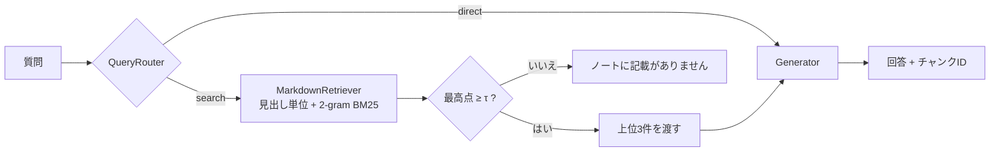

# local-rag-evaluation-pipeline

1つのMarkdownノートに対して、検索・振り分け・生成を通しで動かし、**検索と生成を別々に測る**ための最小のRAGエージェント評価基盤です。
依存はなく(Python 3.10以上の標準ライブラリのみ)、`git clone` した直後に `python bench.py` で評価の表が出ます。

## 構成

```text
├── mock.md          # 評価用のノート(`## 見出し {#sec_xxx}` の形でIDつき)
├── rag_agent.py     # 分割、検索、ルーター、生成、エージェント、CLI
├── bench.py         # 試験10件、6つの指標、条件の比較、Markdownの表の出力
└── requirements.txt # 依存なし(Ollamaは任意)
```



| 部品 | 役割 |
| --- | --- |
| `parse_sections` | `##` の節を1チャンクにする。`###` 以下は親の本文に含める。IDのない `##` やIDの重複は例外で止める(黙って番号を振ると、試験の正解がずれるため) |
| `fixed_chunks` | 比較用の固定長分割(200字)。各断片のIDは、断片の先頭の文字を含む節のID |
| `MarkdownRetriever` | 文字2-gramのBM25(k1=1.5, b=0.75)。日本語は空白で単語に分かれないため、形態素解析なしで使える2-gramにした |
| `QueryRouter` | 挨拶・お礼・自己紹介・計算式は `direct`、それ以外は `search` |
| `ExtractiveGenerator` | 既定。1位の節から、質問と2-gramが最も重なる文を1〜2文返す。LLMなしで、結果は毎回同じ |
| `OllamaGenerator` | 任意。`127.0.0.1` のOllamaの `/api/chat` を温度0で呼ぶ |
| `RAGAgent` | 上の部品を繋ぐ。検索の最高点が閾値τ未満なら「ノートに記載がありません」と返す |

## 評価結果

`python bench.py` の出力です(LLMなし。検索ms・生成msは「平均 / 最大」で、ここだけは実行ごとに揺れます)。

| 条件 | Hit@3 | MRR | Coverage | Routing | Unans. | 検索ms | 生成ms |
|---|---|---|---|---|---|---|---|
| 見出し分割 + 抽出 | 1.00 | 1.00 | 0.67 | 1.00 | 1.00 | 0.02 / 0.04 | 0.04 / 0.10 |
| 固定長200字 + 抽出 | 0.33 | 0.30 | 0.50 | 1.00 | 1.00 | 0.01 / 0.03 | 0.03 / 0.07 |

実行環境: Python 3.14.3, Windows 11 (AMD64)

| 指標 | 定義 | 対象 |
| --- | --- | --- |
| Hit@3 | 正解の節が上位3件に入った割合 | exact 4件 + paraphrase 2件 |
| MRR | 正解の節の順位の逆数の平均(全順位で数え、なければ0) | 同上 |
| Coverage | 必須の語のうち、回答に含まれた割合の平均(NFKC・小文字で比較) | 同上 |
| Routing | ルートの判定が期待どおりだった割合 | 10件すべて |
| Unans. | 「ノートに記載がありません」と返した割合 | unanswerable 2件 |
| 検索ms / 生成ms | 検索と生成を分けた処理時間 | 10件すべて |

試験は `bench.py` の `CASES` に直接書いています。1問ごとの結果は `python bench.py --detail` で見られます。

## 設計判断と、その根拠

- **見出し単位の分割**: 固定長200字と比べて、MRRが0.30から1.00に、Coverageが0.50から0.67に上がった(表の1行目と2行目)。固定長では、節の境目で断片が切れ、別の節の文が混ざった断片が上位に来る(`--detail` のQ01、Q02)。
- **ルーター**: 挨拶と計算式を検索に回さないことを、Routing(1.00)で確かめている。`猫の名前は?` のような、自己紹介に似た語を含む質問も `search` に振れている。
- **検索と生成の分離評価**: Hit@3とCoverageを分けたので、失敗の場所を区別できる。見出し分割のQ05(家庭教師の時給)は、検索は1位で正解したが、抽出型の生成が時給の文を選べず、Coverageが0になった。これは検索ではなく生成の失敗。
- **閾値τ(=5.5)**: 答えのない2件の最高点は3.3と5.4、言い換えの2件は5.9と4.1で、重なっている。推測しないことを優先して5.5にした結果、Unans.は1.00になったが、言い換えのQ06(就寝時刻)は検索で1位だったのに、回答を控えてCoverageを落とした。

## 実行方法

```bash
python bench.py
```

```bash
python bench.py --detail
```

```bash
python rag_agent.py "ゼミ発表の次の担当日はいつ?"
```

LLMの行を加える場合(Ollamaが `127.0.0.1:11434` で動いていること):

```bash
python bench.py --llm qwen3:1.7b
```

## 拡張のしかた

部品は `rag_agent.py` の小さなインターフェースで繋いでいるので、1つずつ差し替えて、`bench.py` の表に1行足すだけで比較できます。

| 差し替えたいもの | 実装するもの | 例 |
| --- | --- | --- |
| 分割 | `Chunker`(`str -> list[Chunk]`) | 見出し + 文字数の上限、重なりつき固定長 |
| 検索 | `Retriever.search(query, k)` | 埋め込みによる検索、BM25との併用 |
| 生成 | `Generator.generate(query, chunks)` | 別のLLM、引用つきの生成 |
| 条件 | `bench.py` の `conditions` に `Condition(...)` を追加 | 新しい組み合わせを同じ試験で測る |

## 限界

- 試験は10件で、統計的な結論ではありません。ノートも架空の1ファイルだけです。
- 閾値τは、この試験データを見て決めました。同じデータで測っているので、Unans.は楽観的な値です。
- 2-gramは言い換えに弱く、語が重ならない質問(例: 「就寝」と「寝て」)では点が低くなります。
- 固定長分割の正解判定は、断片の先頭の文字が属する節で決めています。節の末尾から始まって次の節の大半を含む断片は、不正解として数えられるため、検索の指標(Hit@3、MRR)は固定長に厳しめです。正解の判定に依存しないCoverageも合わせて見てください。
- LLMの行(`--llm`)は、版や環境で出力が揺れるため、参考値として扱います。上の表には含めていません。

## ライセンス

未設定です。
