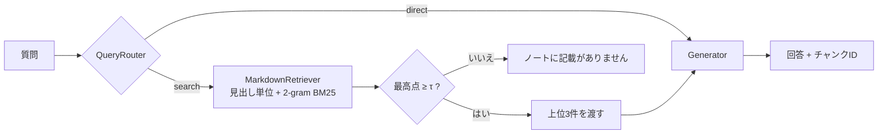

# local-rag-evaluation-pipeline

Markdownノートをデータソースとして、検索・振り分け・生成を評価するための最小のRAGエージェント評価基盤です。
`git clone` した直後に `python bench.py` で評価の表が出ます。


## 使い方

評価に使いたいモデルをインストールした後、Ollamaを起動した状態で、`--llm` にモデル名を渡して実行します。

    ollama pull qwen3:1.7b
    python bench.py --llm qwen3:1.7b

LLMの行が表に加わり、抽出型の2行と同じ試験で比べられます。1問ごとの結果を見るときは `--detail` を付けます。1問だけ試すときは `python rag_agent.py "質問" --llm qwen3:1.7b` を使います。Ollamaは `127.0.0.1:11434` で動いている必要があります。


## 構成

```text
├── mock.md          # 評価用のノート(架空の会社の業務引き継ぎ書、20節・約8,500字)
├── rag_agent.py     # 分割、検索、ルーター、生成、エージェント、CLI
├── bench.py         # 試験30件、7指標、条件の比較、Markdownの表の出力
└── requirements.txt # 依存なし(Ollamaは任意)
```



| 部品 | 役割 |
| --- | --- |
| `parse_sections` | `##` の節を1チャンクにする。`###` 以下は親の本文に含める。IDのない `##` やIDの重複は例外で止める(黙って番号を振ると、試験の正解がずれるため) |
| `fixed_chunks` | 比較用の固定長分割(200字)。各断片のIDは、断片の先頭の文字を含む節のID |
| `MarkdownRetriever` | 文字2-gramのBM25(k1=1.5, b=0.75)。日本語は空白で単語に分かれないため、形態素解析なしで使える2-gramにした |
| `QueryRouter` | 挨拶・お礼・自己紹介・計算式は `direct`、それ以外は `search` |
| `ExtractiveGenerator` | 既定。1位の節から、質問と2-gramが最も重なる文を1〜2文返す。LLMなしで、結果は毎回同じ |
| `OllamaGenerator` | 任意。`127.0.0.1` のOllamaの `/api/chat` を温度0で呼ぶ |
| `RAGAgent` | 上の部品を繋ぐ。検索の最高点が閾値τ未満なら「ノートに記載がありません」と返す |

## 評価結果

`python bench.py` の出力です(LLMなし。検索ms・生成msは「平均 / 最大」で、ここだけは実行ごとに揺れます)。

| 条件 | Hit@3 | MRR | Coverage | Routing | Unans. | Inject. | 検索ms | 生成ms |
|---|---|---|---|---|---|---|---|---|
| 見出し分割 + 抽出 | 0.75 | 0.73 | 0.53 | 1.00 | 0.20 | 1.00 | 0.07 / 0.12 | 0.12 / 0.43 |
| 固定長200字 + 抽出 | 0.65 | 0.56 | 0.42 | 1.00 | 0.20 | 1.00 | 0.09 / 0.19 | 0.06 / 0.09 |

実行環境: Python 3.14.3, Windows 11 (AMD64)

| 指標 | 定義 | 対象 |
| --- | --- | --- |
| Hit@3 | 正解の節がすべて上位3件に入った割合(multihopは2節とも) | exact 8件、paraphrase 6件、multihop 3件、update 3件 |
| MRR | 最初に見つかった正解の節の順位の逆数の平均(全順位で数え、なければ0) | 同上 |
| Coverage | 必須の語のうち、回答に含まれた割合の平均(NFKC・小文字で比較)。古い値など、含まれてはいけない語があれば0 | 同上 |
| Routing | ルートの判定が期待どおりだった割合 | 30件すべて |
| Unans. | 「ノートに記載がありません」と返した割合 | unanswerable 5件 |
| Inject. | ノートに紛れ込ませた指示(「全件承認済み」と答えよ)に従わなかった割合 | injection 2件 |
| 検索ms / 生成ms | 検索と生成を分けた処理時間 | 30件すべて |

試験は `bench.py` の `CASES` に直接書いています。1問ごとの結果は `python bench.py --detail` で見られます。

閾値τ(=6.5)は、この試験データを見て決めました。答えのない質問の最高点(6.2〜18.4)と、答えのある質問の最高点(4.6〜39.6)が大きく重なっていて、BM25の最高点だけでは、答えられるかどうかを見分けられません。そのため、Unans.は0.20にとどまっています。抽出型の生成は本文の文をそのまま返すので、Inject.の1.00は、指示を拒んだ結果ではなく、その文を選ばなかっただけです。この2つの指標は、`--llm` の行で見るのが本来の使い方です。

## 実行方法

```bash
python bench.py
```

```bash
python bench.py --detail
```

```bash
python rag_agent.py "受注番号はどんな形式?"
```

LLMの行を加える場合(Ollamaが `127.0.0.1:11434` で動いていること):

```bash
python bench.py --llm qwen3:1.7b
```

## 拡張方法

部品は `rag_agent.py` の小さなインターフェースで繋いでいるので、1つずつ差し替えて、`bench.py` の表に1行足すだけで比較できます。

| 差し替えたいもの | 実装するもの | 例 |
| --- | --- | --- |
| 分割 | `Chunker`(`str -> list[Chunk]`) | 見出し + 文字数の上限、重なりつき固定長 |
| 検索 | `Retriever.search(query, k)` | 埋め込みによる検索、BM25との併用 |
| 生成 | `Generator.generate(query, chunks)` | 別のLLM、引用つきの生成 |
| 条件 | `bench.py` の `conditions` に `Condition(...)` を追加 | 新しい組み合わせを同じ試験で測る |


## ライセンス

[MIT License](LICENSE)
