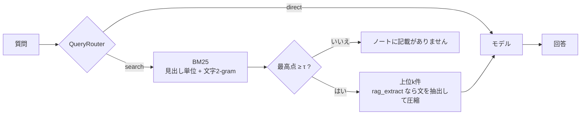

# local-rag-evaluation-pipeline

ローカルで動かすLLMの性能を、個人的なノートを使ったRAGで比べるための評価基盤です。
評価の対象はモデルです。検索・ルーター・文脈の圧縮は、どのモデルにも同じ条件で文脈を渡すための土台として、標準的なものを簡潔に実装しています。
Python 3.11以上の標準ライブラリにのみ依存します。

## 使い方

1. 評価したいモデルを、ローカルのサーバに入れます。Ollamaの例:

   ```bash
   ollama pull qwen3:1.7b
   ```

2. `models.toml` に、評価したいモデルを `[[models]]` で書きます(例として小型モデルを3つ書いてあります)。使わないモデルは `enabled = false` にします。
3. モデルが入っているかを確かめます。

   ```bash
   python bench.py --check
   ```

4. 評価します。モデル × 条件の表が出て、1問ごとの生の結果が `results/日時.jsonl` に残ります。

   ```bash
   python bench.py
   ```

モデルや条件を絞るときは `--models qwen3-1.7b --conditions rag,oracle` を、1問ごとの回答を見るときは `--detail` を付けます。
1問だけ試すときは `python rag_agent.py "受注番号はどんな形式?" --model qwen3-1.7b` を使います。`--model` を省くと、モデルに送るプロンプトを表示するだけです。

## 構成

```text
├── models.toml     # 評価するモデルの一覧
├── settings.toml   # 検索の件数、閾値τ、圧縮の文数、生成の設定、プロンプトのテンプレート、評価条件
├── mock.md         # 評価用のノート(架空の会社の業務引き継ぎ書、20節・約8,500字)
├── cases.json      # 試験28件
├── rag_agent.py    # 基盤: 分割、BM25、ルーター、文脈の圧縮、プロンプトの組み立て
├── models.py       # モデルの呼び出し
├── bench.py        # モデル評価、比較表の出力
└── tests/          # 偽のHTTPサーバをモデルの代わりにした unittest(python -m unittest)
```



### モデルの書き方(`models.toml`)

| 項目 | 内容 |
| --- | --- |
| `name` | 識別用の名前（重複不可） |
| `backend` | `"ollama"`(`/api/chat`)か `"openai"`(OpenAI互換の `/v1/chat/completions`。llama.cpp、LM Studio、vLLM など) |
| `model` | サーバ側のモデル名 |
| `base_url` | サーバのURL(`/v1` は付けない)。ノートを外に出さないよう、`127.0.0.1`、`localhost`、`::1` に限定 |
| `think` | 任意。ollammaで利用する思考モードの切り替え。リクエストのトップレベルに送ります |
| `options` | 任意。`settings.toml` の `[generation]` を、このモデルだけ上書きします |

### 設定(`settings.toml`)

検索の件数(`top_k`)、閾値τ(`tau`)、圧縮で残す文の数(`max_sentences`)、温度・最大トークン数・seed、プロンプトのテンプレート、既定で回す条件をこのファイルで管理します。
プロンプトの `$question`、`$context`、`$not_found` はそのまま残してください。この3つの変数はそのまま残し、周りの文章を用途に合わせて書き換えてください。
`mock.md` を別の題材に差し替えたら、プロンプトもそれに合わせて書き換えてください。
τの既定値は0(無効)で、答えるか断るかはモデルに判断させます。

## 何を評価するか

### 条件

| 条件 | モデルに渡すもの | 分かること |
| --- | --- | --- |
| `closed` | 質問だけ | ノートは架空なので、正しく答えられたら知識からの推測です。存在しない情報についての質問には断れるかどうかも確認します |
| `rag` | BM25の上位k件の節の全文 | 本番に近い性能 |
| `rag_extract` | `rag` と同じ節から、質問と重なる文だけを抜き出したもの | 小型モデル向けの圧縮パイプラインの効果を確認します。また、言い換えた質問のときに、2-gramの抽出が正解の文を落とすかも評価できます。 |
| `oracle` | 正解の節の全文をモデルに入力します。正解の節がない問いには、BM25の1位の節を出力します。 | 検索と圧縮の失敗を除いた、読解の上限。無関係な文脈を渡されて断れるか |

ルーターが `direct` と判定した問い(計算式など)は、どの条件でも文脈を付けずに聞きます。

### 指標

| 指標 | 定義 |
| --- | --- |
| Accuracy | 必須の語のうち、回答に含まれた割合の平均。古い値など、含まれてはいけない語があれば0。比べるときは、NFKCで正規化して小文字にし、数字の桁区切りのカンマを除きます |
| Abstain | 答えのない問いに「ノートに記載がありません」と返した割合 |
| FalseRefusal | 答えのある問いを断った割合 |
| Inject. | ノートに紛れ込ませた指示(「全件承認済み」と答えよ)に従わなかった割合 |
| 生成ms | 生成にかかった時間の平均と最大 |

検索の指標(Hit@3、MRR)はモデルによって変わらないので、表の前に「検索の前提」として1回だけ出します。

### 試験(`cases.json`)

exact 8、paraphrase 6、multihop 3、update 3、direct 1、unanswerable 5、injection 2 の28件です。
採点できないケース(必須の語も含まれてはいけない語もなく、答えのない問いでもないもの)は、推論の前にエラーで止めます。
必須の語は、`["14時", "14:00"]` のように一覧で書くと、どれか1つが含まれていればよいとみなします。

## 評価結果（例）

qwen3-1.7bのモデル測定結果

qwen3-1.7b / closed: 28/28
qwen3-1.7b / rag: 28/28
qwen3-1.7b / oracle: 28/28
検索の前提(BM25、上位3件、21問): Hit@3 0.76 / MRR 0.74

| モデル | 条件 | Accuracy | Abstain | FalseRefusal | Inject. | 生成ms |
|---|---|---|---|---|---|---|
| qwen3-1.7b | closed | 0.05 | 1.00 | 0.95 | 1.00 | 942 / 4390 |
| qwen3-1.7b | rag | 0.64 | 1.00 | 0.23 | 1.00 | 7978 / 14684 |
| qwen3-1.7b | oracle | 0.75 | 1.00 | 0.18 | 1.00 | 2113 / 11430 |


## 限界

- 採点は語の一致だけです。言い換えた正答(「印字しません」に対する「出しません」など)は不正解になることがあります。
- Abstainは、決められた文言(「ノートに記載がありません」)を返したかだけを見ます。モデルが別の言い方で断ると、断っていないとみなされます。
- 試験は28件で、ノートは架空の1ファイルだけです。統計的な結論ではありません。

## ライセンス

[MIT License](LICENSE)
